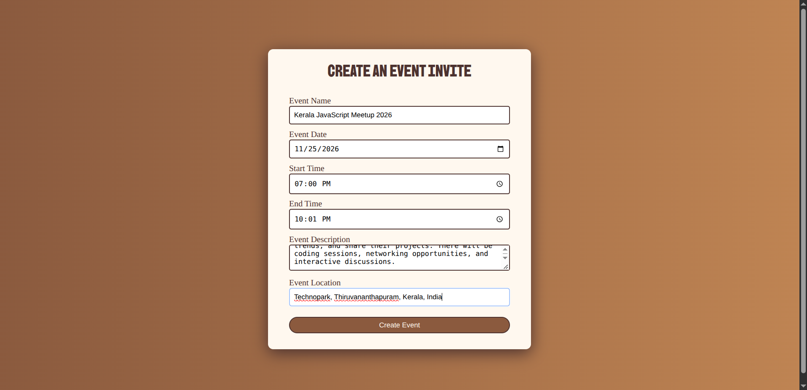
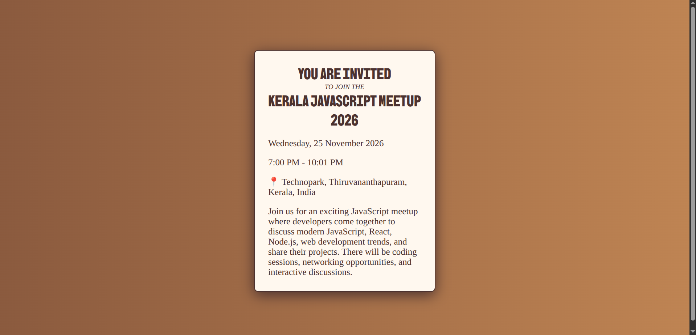

# Event Invite Generator

A small web app where you fill in the details of an event and get a digital invitation card.

**Live demo:** https://blacysins.github.io/Event-Invitation-Creator/

## Screenshots

### Event form



### Invitation card



## Features

- Form with event name, date, start time, end time, location and description
- Custom popup message when any field is left empty (replaces the browser's default validation bubble)
- Submitting the form does not reload the page, the form is hidden and the invitation card is shown
- Date is formatted like "Saturday, December 9, 2024"
- Times are converted to 12-hour format with AM/PM, like "10:00 AM - 4:00 PM"
- User input is inserted with `textContent`, so it is always treated as plain text

## Built with

- HTML
- CSS (flexbox, gradients, transitions)
- JavaScript (DOM manipulation, event listeners, `toLocaleDateString`)

## Project structure

```
.
├── index.html
├── style.css
├── main.js
├── screenshots/
│   ├── form.png
│   └── invitation.png
└── README.md
```

## Run locally

1. Clone the repository:

```
git clone https://github.com/blacysins/Event-Invitation-Creator.git
```

2. Open the folder and double-click `index.html`, or use the Live Server extension in VS Code.

## How it works

1. The user fills in the form and clicks **Create Event**.
2. JavaScript stops the page from reloading and checks that every field has a value.
3. If any field is empty, a popup asks the user to fill in all fields.
4. If all fields are filled, the values are formatted and added to the invitation section, the form is hidden, and the invitation card is shown.

## What I learned

- Controlling visibility with classes (`classList.add` / `classList.remove`)
- The difference between `opacity`, `visibility` and `display: none`
- Event handling, `preventDefault()` and event bubbling (`e.target`)
- Formatting dates and times in JavaScript
